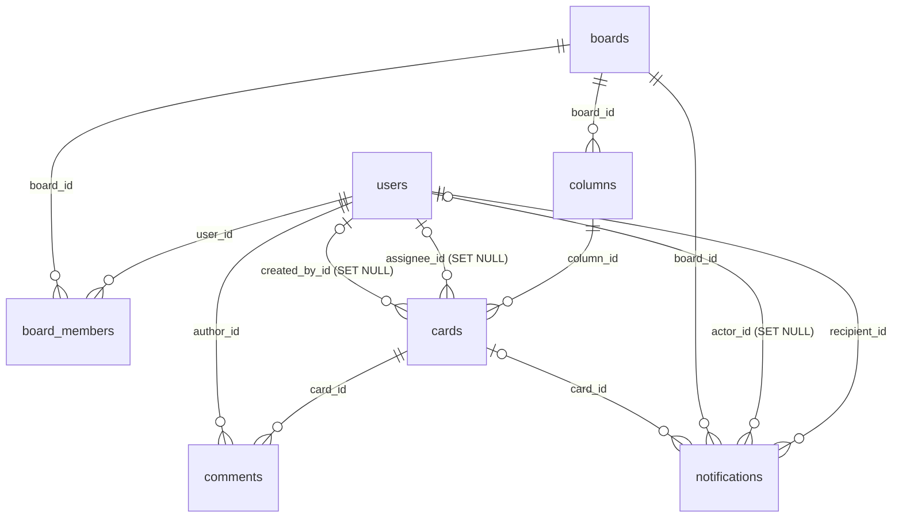

# Technical Design: RevoTask

Sources: `specs/requirements.md` (approved), `specs/project-brief.md`, and the steering files `.kiro/steering/backend.md`, `database.md`, `frontend.md`.

Where this document and a steering example disagree, `requirements.md` wins and the difference is listed in section 1.3.

## 1. Overview

### 1.1 Repository layout

Frontend and backend are separate top-level directories with no shared source imports (REQ-NFR-18 AC1).

```
revotask/
  backend/
    app/
      __init__.py            # create_app(), CORS, error handlers, /api/health
      config.py              # env loading, fails fast on missing variables
      extensions.py          # db, migrate, jwt
      errors.py              # ApiError + central handlers + JWT callbacks
      ordering.py            # ORDER_STEP, MIN_GAP, midpoint(), next_order(), rebalance
      common/
        schema.py            # uuid_str(), StrictSchema, error-message formatter
        queries.py           # get_active_or_404()
      models/
        __init__.py          # imports every model (Alembic autodetect)
        mixins.py            # new_uuid, utcnow, AuditMixin
        user.py  board.py  board_member.py  column.py  card.py  comment.py  notification.py
      blueprints/
        auth/  users/  boards/  columns/  cards/  comments/  notifications/  analytics/
          __init__.py  routes.py  service.py  schema.py
    migrations/              # Flask-Migrate revisions
    tests/
    wsgi.py                  # gunicorn entry: wsgi:app
    railway.json  requirements.txt  .env.example  ruff.toml
  frontend/
    app/  components/  hooks/  lib/  context/  e2e/  tests/
    .env.example  playwright.config.ts  vitest.config.ts  tailwind.config.ts
  specs/
```

### 1.2 Request pipeline (backend)

Every request follows the same order, so status codes are predictable (REQ-NFR-03):

1. JWT check (`@jwt_required()`): `401`.
2. `routes.py`: parse JSON or query, run the Marshmallow schema: `400`.
3. `service.py`: load the resource (`404`), check membership or role or ownership (`403`), apply rules (`400`), write, commit.
4. `routes.py`: wrap the serialized result as `{"data": ...}`.

A request with both an invalid body and a missing permission returns `400` first, because schema validation runs before the service. Tests for `403` must therefore send a valid body.

### 1.3 Decisions and deviations from steering examples

| ID | Decision | Reason |
|---|---|---|
| D-01 | The move endpoint is `PATCH /api/cards/<id>/position`. The `frontend.md` example uses `/move`. | REQ-CRD-06 and REQ-CRD-07 name `/position`. The steering example is illustrative and should be corrected to match. |
| D-02 | JSON keys and TypeScript types use `snake_case` (`column_id`, `completed_at`). The `frontend.md` examples use camelCase in types. | `apiClient` returns `data` unchanged, so types match the wire (REQ-NFR-18 AC2). No key-conversion layer to maintain. |
| D-03 | Lookups use `get_active_or_404(Model, id, "Card")` that raises `ApiError("Card not found", 404)`. The `backend.md` example uses `first_or_404()`. | `first_or_404()` raises a Werkzeug error with a generic message. A named message is more useful to the user. |
| D-04 | The JWT stays in `localStorage` (A-02), and `AuthContext` also mirrors it to a cookie `revotask_token` (`path=/`, `SameSite=Lax`, `Max-Age` equal to the token lifetime). The `/` and `/boards/[boardId]` pages are Server Components that read this cookie and fetch their initial data through `API_BASE_URL`. Client Components do all later fetching through `NEXT_PUBLIC_API_BASE_URL`. | A server cannot read `localStorage`. The cookie gives the server the token without changing A-02, since `localStorage` remains the client's source of truth. The cookie is not `HttpOnly` because JavaScript sets it, so it has the same XSS exposure as `localStorage`. |
| D-05 | Unknown request fields are rejected with `400` on every `PATCH` and `POST` schema (`unknown = RAISE`). | Satisfies REQ-USER-02 AC4 and REQ-CRD-03 AC4 (`column_id`, `order`, `id`, `created_at` cannot be changed). |
| D-06 | Move and reorder responses carry `rebalanced: [{"id", "order"}]`, empty when no rebalance happened. | After a rebalance the client's cached `order` values are stale. REQ-CRD-08 AC5 forbids a re-fetch, so the response carries the new values. |
| D-07 | `GET /api/notifications` returns `unread_count` in addition to the pagination metadata. | The list is paginated (20 per page). Counting unread items in the loaded page would show a wrong badge when more than 20 exist. |
| D-08 | `Card.created_by_id` (nullable FK to `users.id`, `SET NULL`) is added. | REQ-CRD-02 AC2 requires "recent activity entries". Activity is derived from card fields and comments (section 3.6). The creator is the only extra data needed, so no `Activity` model is added. |
| D-09 | A card created directly in the board's last column also gets `completed_at` set. | A-03 defines completion by column position. Setting it at creation keeps the rule consistent. |
| D-10 | Reordering columns or adding a new last column does not recompute `completed_at` of existing cards. | A-03 sets and clears `completed_at` on card moves only. Recomputing would touch many rows. Open question 1 in the requirements (explicit "done" flag) would remove this limitation. |
| D-11 | Membership re-add after removal restores the soft-deleted `board_members` row. | The `UniqueConstraint(board_id, user_id)` also covers soft-deleted rows. Inserting a second row would violate it. |
| D-12 | Email is stored lowercase. The `users.email` unique index also covers soft-deleted users. | Case-insensitive uniqueness (A-01) without a functional index. |
| D-13 | On an exact `order` collision during a move, the moved card sorts after the card it collided with. | The server only receives a number, so it cannot know which side the user meant. REQ-CRD-06 AC4 only requires the card to "land in the requested position". |
| D-14 | Column reordering has an API but no UI. | REQ-COL-07 lists only add, rename, and delete. `lib/ordering.ts` is reusable if a UI is added later. |

### 1.4 Dependency justification (REQ-NFR-17 AC3)

Every package below is outside the brief's listed stack.

| Package | Where | Justification |
|---|---|---|
| Flask-SQLAlchemy | backend | Steering uses `db.Model`, `db.Column`, `Model.query`. It is the standard Flask integration for SQLAlchemy and Flask-Migrate. |
| psycopg2-binary | backend | PostgreSQL driver required by SQLAlchemy. |
| python-dotenv | backend | Lets `flask` commands read `.env` in development (REQ-NFR-01). |
| ruff | backend (dev) | Backend linter required by REQ-NFR-18 AC3. |
| Vitest, @testing-library/react, jsdom | frontend (dev) | Fake-timer and render-count tests (REQ-SRC-02 AC1, REQ-NTF-05 AC1, REQ-NFR-10 AC4) are hook-level tests. Playwright is used for E2E only. |
| ESLint, eslint-config-next | frontend (dev) | Frontend linter required by REQ-NFR-18 AC3. Installed by `create-next-app`. |

Password hashing uses `werkzeug.security` (scrypt), which ships with Flask. No extra package is needed.

---

## 2. Database Schema

PostgreSQL, SQLAlchemy through Flask-SQLAlchemy, migrations through Flask-Migrate only (REQ-NFR-08). Models live in `app/models/`.

### 2.1 Shared base (`app/models/mixins.py`)

```python
import uuid
from datetime import datetime, timezone
from app.extensions import db


def new_uuid() -> str:
    return str(uuid.uuid4())


def utcnow() -> datetime:
    return datetime.now(timezone.utc)


class AuditMixin:
    created_at = db.Column(db.DateTime(timezone=True), nullable=False, default=utcnow)
    updated_at = db.Column(
        db.DateTime(timezone=True), nullable=False, default=utcnow, onupdate=utcnow
    )
    deleted_at = db.Column(db.DateTime(timezone=True), nullable=True, index=True)

    def soft_delete(self) -> None:
        self.deleted_at = utcnow()

    @classmethod
    def active(cls):
        return cls.query.filter(cls.deleted_at.is_(None))
```

Notes:

- The model named `Column` always uses `db.Column` inside model files and never imports SQLAlchemy's `Column` by name, so the two names cannot collide.
- `order` is a reserved SQL word. SQLAlchemy quotes it automatically, so no manual quoting is needed.
- `db.session.query(...)` and joins in services must add `deleted_at.is_(None)` for every joined table explicitly, because `active()` only covers the primary model.

### 2.2 Models

```python
# app/models/user.py
class User(AuditMixin, db.Model):
    __tablename__ = "users"
    id = db.Column(db.String(36), primary_key=True, default=new_uuid)
    name = db.Column(db.String(120), nullable=False)
    email = db.Column(db.String(255), nullable=False, unique=True, index=True)  # stored lowercase
    password_hash = db.Column(db.String(255), nullable=False)


# app/models/board.py
class Board(AuditMixin, db.Model):
    __tablename__ = "boards"
    id = db.Column(db.String(36), primary_key=True, default=new_uuid)
    name = db.Column(db.String(120), nullable=False)


# app/models/board_member.py
class BoardMember(AuditMixin, db.Model):
    __tablename__ = "board_members"
    id = db.Column(db.String(36), primary_key=True, default=new_uuid)
    board_id = db.Column(db.String(36), db.ForeignKey("boards.id"), nullable=False, index=True)
    user_id = db.Column(db.String(36), db.ForeignKey("users.id"), nullable=False, index=True)
    role = db.Column(db.String(10), nullable=False, default="member")  # "member" | "admin"

    user = db.relationship("User", lazy="joined")

    __table_args__ = (
        db.UniqueConstraint("board_id", "user_id", name="uq_board_members_board_user"),
        db.CheckConstraint("role IN ('member', 'admin')", name="ck_board_members_role"),
    )


# app/models/column.py
class Column(AuditMixin, db.Model):
    __tablename__ = "columns"
    id = db.Column(db.String(36), primary_key=True, default=new_uuid)
    board_id = db.Column(db.String(36), db.ForeignKey("boards.id"), nullable=False)
    name = db.Column(db.String(120), nullable=False)
    order = db.Column(db.Float, nullable=False)

    __table_args__ = (db.Index("ix_columns_board_id_order", "board_id", "order"),)


# app/models/card.py
class Card(AuditMixin, db.Model):
    __tablename__ = "cards"
    id = db.Column(db.String(36), primary_key=True, default=new_uuid)
    column_id = db.Column(db.String(36), db.ForeignKey("columns.id"), nullable=False)
    title = db.Column(db.String(200), nullable=False)
    description = db.Column(db.Text, nullable=True)
    assignee_id = db.Column(
        db.String(36), db.ForeignKey("users.id", ondelete="SET NULL"), nullable=True, index=True
    )
    created_by_id = db.Column(
        db.String(36), db.ForeignKey("users.id", ondelete="SET NULL"), nullable=True
    )
    due_date = db.Column(db.DateTime(timezone=True), nullable=True)
    order = db.Column(db.Float, nullable=False)
    completed_at = db.Column(db.DateTime(timezone=True), nullable=True, index=True)

    assignee = db.relationship("User", foreign_keys=[assignee_id], lazy="joined")
    column = db.relationship("Column", lazy="joined")

    __table_args__ = (db.Index("ix_cards_column_id_order", "column_id", "order"),)


# app/models/comment.py
class Comment(AuditMixin, db.Model):
    __tablename__ = "comments"
    id = db.Column(db.String(36), primary_key=True, default=new_uuid)
    card_id = db.Column(db.String(36), db.ForeignKey("cards.id"), nullable=False, index=True)
    author_id = db.Column(db.String(36), db.ForeignKey("users.id"), nullable=False, index=True)
    body = db.Column(db.Text, nullable=False)  # 1..2000 chars, enforced by schema

    author = db.relationship("User", lazy="joined")


# app/models/notification.py
NOTIFICATION_TYPES = ("card_assigned", "comment_added", "board_member_added")


class Notification(AuditMixin, db.Model):
    __tablename__ = "notifications"
    id = db.Column(db.String(36), primary_key=True, default=new_uuid)
    recipient_id = db.Column(db.String(36), db.ForeignKey("users.id"), nullable=False, index=True)
    actor_id = db.Column(
        db.String(36), db.ForeignKey("users.id", ondelete="SET NULL"), nullable=True
    )
    board_id = db.Column(db.String(36), db.ForeignKey("boards.id"), nullable=False)
    card_id = db.Column(db.String(36), db.ForeignKey("cards.id"), nullable=True)
    type = db.Column(db.String(30), nullable=False)
    message = db.Column(db.String(255), nullable=False)
    read_at = db.Column(db.DateTime(timezone=True), nullable=True)

    __table_args__ = (
        db.CheckConstraint(
            "type IN ('card_assigned', 'comment_added', 'board_member_added')",
            name="ck_notifications_type",
        ),
    )
```

### 2.3 Entity relationships



### 2.4 Index inventory (REQ-NFR-09 AC1)

| Index | Declared by |
|---|---|
| `cards(column_id, order)` | `ix_cards_column_id_order` |
| `cards.assignee_id` | `index=True` |
| `cards.completed_at` | `index=True` |
| `board_members.board_id`, `board_members.user_id` | `index=True` |
| `columns(board_id, order)` | `ix_columns_board_id_order` |
| `comments.card_id` | `index=True` |
| `notifications.recipient_id` | `index=True` |
| `<every table>.deleted_at` | `AuditMixin.deleted_at` (`index=True`) |
| `users.email` (unique) | `unique=True, index=True` |
| `board_members(board_id, user_id)` (unique) | `uq_board_members_board_user` |

### 2.5 Ordering module (`app/ordering.py`)

```python
ORDER_STEP = 1000.0
MIN_GAP = 1e-6


def midpoint(prev_order: float | None, next_order: float | None) -> float:
    if prev_order is None and next_order is None:
        return ORDER_STEP
    if prev_order is None:
        return next_order / 2
    if next_order is None:
        return prev_order + ORDER_STEP
    return (prev_order + next_order) / 2


def next_order(model, scope_filter) -> float:
    """Order for a new last item: 1000.0 when the scope is empty, else max + 1000.0."""
    last = (
        db.session.query(func.max(model.order))
        .filter(scope_filter, model.deleted_at.is_(None))
        .scalar()
    )
    return ORDER_STEP if last is None else last + ORDER_STEP


def needs_rebalance(model, scope_filter, item_id: str, order: float) -> bool:
    """True when another active item in scope is closer than MIN_GAP (includes equality)."""
    return db.session.query(
        db.session.query(model.id)
        .filter(scope_filter, model.deleted_at.is_(None), model.id != item_id,
                func.abs(model.order - order) < MIN_GAP)
        .exists()
    ).scalar()


def rebalance(model, scope_filter, moved_id: str) -> list[dict]:
    """Reassign 1000.0, 2000.0, ... in one transaction. Returns [{"id", "order"}, ...]."""
    with db.session.begin_nested():
        items = (
            model.active().filter(scope_filter)
            .order_by(model.order).with_for_update().all()
        )
        # exact ties: the moved item sorts after the item it collided with (D-13)
        items.sort(key=lambda i: (i.order, i.id == moved_id))
        for index, item in enumerate(items, start=1):
            item.order = index * ORDER_STEP
    return [{"id": i.id, "order": i.order} for i in items]
```

Scope: for `Card` the filter is `Card.column_id == target_column_id`. For `Column` it is `Column.board_id == board_id`.

### 2.6 Migrations

- One initial revision creates all seven tables. Each later model change ships with its own revision (REQ-NFR-08 AC4).
- `db.create_all()` appears only in `tests/conftest.py`.
- Tests run against PostgreSQL (`TEST_DATABASE_URL`) so `ilike`, `FLOAT`, and constraints behave as in production.

---

## 3. Backend Design

### 3.1 App factory and configuration

```python
# app/config.py
import os

def require_env(name: str) -> str:
    value = os.environ.get(name)
    if not value:
        raise RuntimeError(f"Missing required environment variable: {name}")
    return value

class Config:
    def __init__(self):
        url = require_env("DATABASE_URL")
        self.SQLALCHEMY_DATABASE_URI = url.replace("postgres://", "postgresql://", 1)
        self.JWT_SECRET_KEY = require_env("JWT_SECRET_KEY")
        self.FRONTEND_URL = require_env("FRONTEND_URL").rstrip("/")
        self.JWT_ACCESS_TOKEN_EXPIRES = timedelta(minutes=int(os.environ.get("JWT_EXPIRES_MINUTES", "60")))
```

```python
# app/__init__.py
def create_app(config=None):
    app = Flask(__name__)
    app.config.from_object(config or Config())
    app.url_map.strict_slashes = False
    db.init_app(app); migrate.init_app(app, db); jwt.init_app(app)
    CORS(app, resources={r"/api/*": {"origins": app.config["FRONTEND_URL"]}})
    register_error_handlers(app)
    for bp in (auth_bp, users_bp, boards_bp, columns_bp, cards_bp,
               comments_bp, notifications_bp, analytics_bp):
        app.register_blueprint(bp)

    @app.get("/api/health")
    def health():
        return jsonify({"data": {"status": "ok"}}), 200
    return app
```

Environment variables: `DATABASE_URL`, `JWT_SECRET_KEY`, `FRONTEND_URL` (required), `JWT_EXPIRES_MINUTES` (optional, default 60). `.env.example` lists them with placeholder values. Blueprints have no `url_prefix`. Each route declares its full `/api/...` path, as in the steering example.

### 3.2 Errors and the envelope (`app/errors.py`)

```python
class ApiError(Exception):
    def __init__(self, message: str, status: int):
        self.message, self.status = message, status

def format_validation(messages: dict) -> str:
    # {"email": ["Not a valid email address."]} -> "email: Not a valid email address."
    return "; ".join(f"{field}: {' '.join(map(str, errs))}" for field, errs in flatten(messages))

def register_error_handlers(app):
    @app.errorhandler(ApiError)
    def api_error(e):             return jsonify({"error": e.message}), e.status
    @app.errorhandler(ValidationError)
    def validation(e):            return jsonify({"error": format_validation(e.messages)}), 400
    @app.errorhandler(HTTPException)
    def http_error(e):            return jsonify({"error": e.name}), e.code   # unknown route -> 404, 405
    @app.errorhandler(Exception)
    def unexpected(e):
        app.logger.exception(e)
        return jsonify({"error": "Internal server error"}), 500

    # Flask-JWT-Extended: every failure is 401 with the flat envelope
    @jwt.unauthorized_loader
    def missing(reason):          return jsonify({"error": "Authentication required"}), 401
    @jwt.invalid_token_loader
    def invalid(reason):          return jsonify({"error": "Invalid token"}), 401
    @jwt.expired_token_loader
    def expired(header, payload): return jsonify({"error": "Token has expired"}), 401
```

The `HTTPException` handler makes unknown routes (for example `/api/analytics/cards-per-column` or `PATCH /api/users/me/password`) return `404` with `{"error": "Not Found"}`. The log never records request bodies, so passwords do not reach logs (REQ-AUTH-02 AC3).

### 3.3 Shared schema helpers (`app/common/schema.py`)

- `uuid_str(**kw)`: `fields.String` with a UUID regex validator. Used for every id in a body, so a non-UUID value returns `400` (REQ-CRD-06 AC6).
- `StrictSchema(Schema)`: `class Meta: unknown = RAISE`. All request schemas extend it (D-05). Marshmallow's message for an unknown field is `Unknown field.`.
- `CardPositionSchema` is documented in section 3.5 (Cards). Unlike the other `PATCH` schemas it is not loaded with `partial=True`.
- `order_field()`: `fields.Float(required=True, allow_nan=False, validate=Range(min=0, min_inclusive=False))`.
- Every `PATCH` schema is loaded with `partial=True`. An empty body (no recognised field) returns `400` `"No fields to update"` from the service.

### 3.4 Authorization (`boards/service.py`)

`require_member(user_id, board_id, admin=False)` is the only place that decides board access, as in the steering example. Other services call it.

| Resource | Board is found through |
|---|---|
| column | `column.board_id` |
| card | `card.column.board_id` |
| comment | `comment.card.column.board_id` (author check for edit and delete only) |
| analytics | board id in URL, `admin=True` |

Lookup order for a board-scoped resource is: load resource (`404`), then `require_member` (`403`). A soft-deleted board makes `Board.active()` return nothing, so every child route returns `404`.

### 3.5 Domain rules by feature

**Auth (`auth/service.py`)**

- Register: lowercase the email, reject an existing email (any case, including soft-deleted) with `400 "Email is already registered"`, hash with `generate_password_hash`.
- Login: lowercase the email, load `User.active()`. Wrong password and unknown email both return `401 "Invalid email or password"`. When the user is not found, the service still runs `check_password_hash` on a dummy hash so response time does not reveal which emails exist.
- Token: `create_access_token(identity=user.id)`. `sub` equals the user id (REQ-AUTH-03 AC4).

**Users (`users/service.py`)**

- `UserUpdateSchema` allows `name` (1 to 120) and `email`. A `password` key fails with `"password: Password cannot be changed through this endpoint"`. Other unknown keys (`id`, `created_at`, `password_hash`) fail with `Unknown field.` (D-05). Validation happens before any write, so a rejected request changes nothing (REQ-USER-03 AC2).
- `GET /api/users?email=` is an exact, case-insensitive match on one user. It never lists users.

**Boards (`boards/service.py`)**

- `create_board`: one transaction inserts the `Board` and the creator's `BoardMember(role="admin")`.
- `get_board_detail`: constant queries (REQ-NFR-09 AC2): (1) board, (2) caller membership, (3) active columns ordered by `order`, (4) all active cards of those columns ordered by `order` with the assignee joined. Cards are grouped by column in Python. This groups already-fetched rows and does not query per column.
- `delete_board`: admin only. Sets `deleted_at` on the board, then runs bulk `UPDATE ... SET deleted_at` on its columns, the cards of those columns, and the comments of those cards (A-08). Memberships are left as they are. The board is already unreachable because its own `deleted_at` is set.
- `add_member`: admin only. Look up the user by lowercase email (`404` if absent). If an active membership exists, `400`. If a soft-deleted membership exists, restore it and set the role (D-11). Otherwise insert. Adds a `board_member_added` notification in the same transaction.
- `change_role` and `remove_member`: admin only. Both check the last-admin rule (A-07): when the target is an active admin and the board has no other active admin, return `400`. `remove_member` sets `deleted_at` on the membership and runs `UPDATE cards SET assignee_id = NULL` for cards in that board's active columns assigned to that user (REQ-BRD-09 AC3).

**Columns (`columns/service.py`)**

- `create_column`: `order = next_order(Column, Column.board_id == board_id)`.
- `reorder_column(user_id, board_id, payload)`: loads the board (`404`), `require_member` (`403`), loads the column and checks `column.board_id == board_id` (`400` otherwise), sets `column.order = payload["order"]`, then calls `needs_rebalance`. If true, `rebalance(Column, Column.board_id == board_id, column.id)`. One commit.
- `delete_column`: soft-deletes the column, its cards, and the comments of those cards by bulk `UPDATE`.

**Cards (`cards/service.py`)**

- `create_card`: `require_member`, validate the assignee (below), `order = next_order(Card, Card.column_id == column_id)`, set `created_by_id`. If the column is the board's last column, set `completed_at` (D-09). If an assignee was given and differs from the caller, add a `card_assigned` notification.
- Assignee validation: `assignee_id` must be an active member of the card's board, otherwise `400 "Assignee must be a member of this board"` (REQ-CRD-04 AC2). `null` clears the assignment. A notification is created only when the assignee changes to a user other than the caller.
- `move_card(user_id, card_id, payload)`:
  1. Load the card (`404`). Resolve the source board. `require_member` (`403`).
  2. Load the target column (`404`). If `target.board_id != source_board_id`, raise `ApiError("Cannot move a card to another board", 400)`. The card is unchanged.
  3. Set `card.column_id` and `card.order` to the received values. Only this one card row is written.
  4. If the column changed, apply the completion rule: let `last_id` be the active column of the board with the highest `order`. If `target.id == last_id` and `completed_at is None`, set it to `utcnow()`. If `target.id != last_id`, set it to `None`. A move inside one column never touches `completed_at` (REQ-CRD-06 AC8).
  5. `needs_rebalance(Card, Card.column_id == target.id, card.id, order)`. If true, `rebalance(...)` and return its list as `rebalanced`.
  6. Commit once.
- `CardPositionSchema(StrictSchema)` (in `cards/schema.py`) validates the body of `PATCH /api/cards/<id>/position`. It is loaded without `partial=True`, so both fields are required:
```python
class CardPositionSchema(StrictSchema):
    column_id = uuid_str(required=True)   # UUID string, otherwise 400
    order = order_field()                 # float > 0 (Range(min=0, min_inclusive=False)), NaN rejected
```
  A missing field, a `column_id` that is not a UUID, an `order` that is not a number, `order <= 0`, or any unknown key returns `400` with field errors, before `move_card` runs (REQ-CRD-06 AC6, D-05).
- `search_cards(user_id, board_id, q)`: the `LIKE` pattern escapes the characters `\`, `%`, and `_` so they match literally (REQ-SRC-01 AC7).

```python
def _escape_like(text: str) -> str:
    return text.replace("\\", "\\\\").replace("%", "\\%").replace("_", "\\_")

def search_cards(user_id, board_id, q):
    board_service.require_member(user_id, get_active_or_404(Board, board_id, "Board").id)
    query = (
        Card.active().join(Column, Card.column_id == Column.id)
        .filter(Column.board_id == board_id, Column.deleted_at.is_(None))
    )
    if q:
        pattern = f"%{_escape_like(q)}%"
        query = query.filter(or_(
            Card.title.ilike(pattern, escape="\\"),
            Card.description.ilike(pattern, escape="\\"),
        ))
    return query.order_by(Card.order).all()
```

- `list_my_tasks(user_id)`: joins `Card -> Column -> Board -> BoardMember`. Filters: `Card.assignee_id == user_id`, `Card`, `Column`, `Board`, and `BoardMember` all `deleted_at IS NULL`, and `BoardMember.user_id == user_id`. Items are returned with `board_name` and `column_name` from the joins. Totals come from one aggregate query over the same filter: `count(Card.id)` as `total` and `count(Card.completed_at)` as `completed`. `open = total - completed`.
- `get_card_detail`: card, active comments ordered by `created_at` ascending (author joined), and `activity` (section 3.6).

**Comments (`comments/service.py`)**

- Add: `require_member` on the card's board. `author_id` comes from the JWT. If the card has an assignee other than the author, add a `comment_added` notification for the assignee.
- Edit and delete: load the comment (`404`), compare `author_id` to the caller (`403`) before any change. Board admins are not exempt (REQ-CMT-03 AC2). Delete is a soft delete.

**Notifications (`notifications/service.py`)**

- `notify(recipient_id, actor_id, board_id, card_id, type, message)` does `db.session.add(...)` and no commit. It returns without adding anything when `recipient_id == actor_id` (REQ-NTF-02 AC4). The calling service commits once, so the notification and the action are stored together or not at all (REQ-NTF-02 AC5).
- Messages: `card_assigned` is `"<actor> assigned you to \"<card title>\""`. `comment_added` is `"<actor> commented on \"<card title>\""`. `board_member_added` is `"<actor> added you to <board name>"`.
- `list_notifications`: `Notification.active()` for `recipient_id == caller`, ordered by `created_at` descending, paged with `limit/offset`. `PaginationSchema` rules: `page` integer at least 1 (default 1), `per_page` integer from 1 to 100 (default 20). A page past the end returns an empty `items`. `pages = ceil(total / per_page)`. `unread_count` is a separate `count` where `read_at IS NULL` (D-07).
- `mark_read`: `404` if absent, `403` if `recipient_id != caller`. If `read_at` is already set, nothing changes (idempotent). `mark_all_read` runs one `UPDATE ... WHERE recipient_id = :me AND read_at IS NULL AND deleted_at IS NULL` and returns the row count.

**Analytics (`analytics/service.py`)**

`get_analytics(user_id, board_id)` loads the board (`404`), calls `require_member(admin=True)` (`403`), then runs aggregation queries. No card rows are loaded into Python.

```python
def week_start(now: datetime) -> datetime:
    monday = (now - timedelta(days=now.weekday())).astimezone(timezone.utc)
    return monday.replace(hour=0, minute=0, second=0, microsecond=0)

def get_analytics(user_id, board_id, now=None):
    ...
    start = week_start(now or utcnow())
    return {
        "cards_per_column": cards_per_column(board_id),            # outer join + group_by
        "completed_this_week": {"count": completed_this_week(board_id, start),
                                "week_start": start.isoformat()},
        "member_activity": member_activity(board_id, start),
    }
```

`cards_per_column` and `completed_this_week` follow the steering examples. `member_activity` is three grouped subqueries outer-joined to the member list, so members without activity return zeros:

```python
active_cards = (
    db.session.query(Card.id, Card.assignee_id, Card.completed_at)
    .join(Column, Card.column_id == Column.id)
    .filter(Column.board_id == board_id, Column.deleted_at.is_(None), Card.deleted_at.is_(None))
    .subquery()
)
assigned = (db.session.query(active_cards.c.assignee_id.label("uid"),
                             func.count().label("n"))
            .group_by(active_cards.c.assignee_id).subquery())
done = (db.session.query(active_cards.c.assignee_id.label("uid"), func.count().label("n"))
        .filter(active_cards.c.completed_at >= start)
        .group_by(active_cards.c.assignee_id).subquery())
commented = (db.session.query(Comment.author_id.label("uid"), func.count().label("n"))
             .join(active_cards, Comment.card_id == active_cards.c.id)
             .filter(Comment.deleted_at.is_(None))
             .group_by(Comment.author_id).subquery())

rows = (
    db.session.query(User.id, User.name,
                     func.coalesce(assigned.c.n, 0), func.coalesce(done.c.n, 0),
                     func.coalesce(commented.c.n, 0))
    .join(BoardMember, BoardMember.user_id == User.id)
    .outerjoin(assigned, assigned.c.uid == User.id)
    .outerjoin(done, done.c.uid == User.id)
    .outerjoin(commented, commented.c.uid == User.id)
    .filter(BoardMember.board_id == board_id, BoardMember.deleted_at.is_(None))
    .order_by(User.name).all()
)
```

The week boundary is inclusive (`>= start`), so a card completed one second earlier is excluded (REQ-ANL-02 AC3). `week_start` takes `now` as a parameter so tests can pin the clock.

### 3.6 Card activity (derived, no new table)

`get_card_detail` builds `activity` in memory from data it already loaded (card fields and comments), newest first, limited to 10:

| `type` | Source | `actor` |
|---|---|---|
| `card_created` | `card.created_at` | `created_by_id` user (null if unknown) |
| `card_completed` | `card.completed_at` when not null | null |
| `comment_added` | each active comment | comment author |

### 3.7 Deployment (REQ-NFR-16)

- `wsgi.py` exposes `app = create_app()`. Start command: `gunicorn wsgi:app --bind 0.0.0.0:$PORT`.
- `railway.json` sets the start command and a pre-deploy command `flask db upgrade`, so migrations run on each release. The exact `railway.json` keys must be checked against the current Railway documentation when the file is written.
- Vercel builds `frontend/` with `API_BASE_URL` and `NEXT_PUBLIC_API_BASE_URL` set to the Railway URL. Railway's `FRONTEND_URL` is the Vercel origin.

---

## 4. API Contract Inventory

### 4.1 Conventions

- Base path `/api`. Content type `application/json`.
- Protected endpoints require `Authorization: Bearer <access_token>`.
- Success: `200` or `201` with `{"data": <payload>}`.
- Failure: `{"error": "<string>"}` with `400`, `401`, `403`, `404`, or `500`.
- Timestamps are ISO 8601 UTC strings (`2025-11-17T20:13:00+00:00`). Ids are UUID strings. `order` is a float.
- Delete endpoints return `200 {"data": {"id": "<id>"}}`.
- Unless a row lists otherwise, every protected endpoint can also return `401`. Board-scoped endpoints return `403` for non-members and `404` for unknown or soft-deleted resources.

### 4.2 Shared response objects

These are the payload shapes. `frontend/lib/types.ts` declares the same names with the same keys.

```ts
type UserPublic   = { id: string; name: string; email: string };
type UserProfile  = UserPublic & { created_at: string };

type BoardSummary = { id: string; name: string; role: "member" | "admin";
                      created_at: string; updated_at: string };
type Member       = { user_id: string; name: string; email: string; role: "member" | "admin" };

type ColumnItem   = { id: string; board_id: string; name: string; order: number;
                      created_at: string; updated_at: string };

type Card = {
  id: string; column_id: string; board_id: string;
  title: string; description: string | null;
  assignee_id: string | null; assignee: { id: string; name: string } | null;
  due_date: string | null; order: number; completed_at: string | null;
  created_at: string; updated_at: string;
};

type BoardDetail = BoardSummary & {
  columns: (ColumnItem & { cards: Card[] })[];     // columns and cards sorted by order ascending
};

type Comment = { id: string; card_id: string; author_id: string; author_name: string;
                 body: string; created_at: string; updated_at: string };

type ActivityEntry = { type: "card_created" | "card_completed" | "comment_added";
                       actor_id: string | null; actor_name: string | null; created_at: string };

type CardDetail = Card & { comments: Comment[]; activity: ActivityEntry[] };

type Rebalanced   = { rebalanced: { id: string; order: number }[] };   // D-06

type NotificationItem = { id: string; type: "card_assigned" | "comment_added" | "board_member_added";
                          message: string; board_id: string; card_id: string | null;
                          read_at: string | null; created_at: string };
type NotificationPage = { items: NotificationItem[]; page: number; per_page: number;
                          total: number; pages: number; unread_count: number };

type TaskItem  = { id: string; title: string; board_id: string; board_name: string;
                   column_name: string; due_date: string | null; completed_at: string | null };
type TaskList  = { items: TaskItem[]; total: number; completed: number; open: number };

type Analytics = {
  cards_per_column: { column_id: string; name: string; count: number }[];
  completed_this_week: { count: number; week_start: string };
  member_activity: { user_id: string; name: string; assigned_count: number;
                     completed_this_week: number; comments_count: number }[];
};
```

Example success and error bodies:

```json
{"data": {"status": "ok"}}
{"data": {"id": "0b7e...", "column_id": "5c1a...", "order": 1500.0, "rebalanced": []}}
{"error": "email: Not a valid email address."}
{"error": "You do not have access to this board"}
{"error": "Internal server error"}
```

### 4.3 Health (app factory, not a blueprint)

| Method | Path | Auth | Request | Success | Errors |
|---|---|---|---|---|---|
| GET | `/api/health` | none | none | `200 {"data": {"status": "ok"}}` | none |

### 4.4 Blueprint `auth` (public)

| Method | Path | Request | Success | Errors |
|---|---|---|---|---|
| POST | `/api/auth/register` | `{"name": str 1-120, "email": str, "password": str 8-128}` | `201 {"data": UserPublic}` | `400` missing field, invalid email, short password, duplicate email (any case) |
| POST | `/api/auth/login` | `{"email": str, "password": str}` | `200 {"data": {"access_token": str, "user": UserPublic}}` | `400` missing field. `401 "Invalid email or password"` for wrong password, unknown email, or soft-deleted user |

### 4.5 Blueprint `users`

| Method | Path | Request | Success | Errors |
|---|---|---|---|---|
| GET | `/api/users/me` | none | `200 {"data": UserProfile}` | `401` |
| PATCH | `/api/users/me` | `{"name"?: str 1-120, "email"?: str}` | `200 {"data": UserProfile}` | `400` empty name, invalid or duplicate email, `password` key, any other unknown key, empty body. `401` |
| GET | `/api/users?email=<email>` | query `email` (required) | `200 {"data": UserPublic}` | `400` missing `email`. `401`. `404` no such user |

`PATCH /api/users/me/password` is not defined and returns `404`.

### 4.6 Blueprint `boards`

| Method | Path | Role | Request | Success | Errors |
|---|---|---|---|---|---|
| GET | `/api/boards` | authenticated | none | `200 {"data": [BoardSummary]}` (empty list when none) | `401` |
| POST | `/api/boards` | authenticated | `{"name": str 1-120}` | `201 {"data": BoardSummary}` (`role: "admin"`) | `400`, `401` |
| GET | `/api/boards/<id>` | member | none | `200 {"data": BoardDetail}` | `401`, `403`, `404` |
| PATCH | `/api/boards/<id>` | admin | `{"name": str 1-120}` | `200 {"data": BoardSummary}` | `400`, `401`, `403`, `404` |
| DELETE | `/api/boards/<id>` | admin | none | `200 {"data": {"id": str}}` | `401`, `403`, `404` |
| GET | `/api/boards/<id>/members` | member | none | `200 {"data": [Member]}` | `401`, `403`, `404` |
| POST | `/api/boards/<id>/members` | admin | `{"email": str, "role"?: "member" or "admin"}` (default `member`) | `201 {"data": Member}` | `400` invalid role, already a member. `401`, `403`. `404` board or unregistered email |
| PATCH | `/api/boards/<id>/members/<user_id>` | admin | `{"role": "member" or "admin"}` | `200 {"data": Member}` | `400` invalid role, last admin. `401`, `403`. `404` board or member |
| DELETE | `/api/boards/<id>/members/<user_id>` | admin | none | `200 {"data": {"id": "<user_id>"}}` | `400` last admin. `401`, `403`. `404` board or member |

### 4.7 Blueprint `columns`

| Method | Path | Role | Request | Success | Errors |
|---|---|---|---|---|---|
| GET | `/api/boards/<board_id>/columns` | member | none | `200 {"data": [ColumnItem]}` sorted by `order` | `401`, `403`, `404` |
| POST | `/api/boards/<board_id>/columns` | member | `{"name": str 1-120}` | `201 {"data": ColumnItem}` | `400`, `401`, `403`, `404` |
| PATCH | `/api/boards/<board_id>/columns/reorder` | member | `{"column_id": uuid, "order": float > 0}` | `200 {"data": ColumnItem & Rebalanced}` | `400` invalid body, `column_id` not on this board. `401`, `403`, `404` |
| PATCH | `/api/columns/<id>` | member | `{"name": str 1-120}` | `200 {"data": ColumnItem}` | `400`, `401`, `403`, `404` |
| DELETE | `/api/columns/<id>` | member | none | `200 {"data": {"id": str}}` | `401`, `403`, `404` |

There is no endpoint that changes a column's `board_id` (REQ-COL-06 AC3).

### 4.8 Blueprint `cards`

| Method | Path | Role | Request | Success | Errors |
|---|---|---|---|---|---|
| POST | `/api/columns/<column_id>/cards` | member | `{"title": str 1-200, "description"?: str, "assignee_id"?: uuid or null, "due_date"?: ISO datetime or null}` | `201 {"data": Card}` | `400` missing title, assignee not a board member. `401`, `403`, `404` |
| GET | `/api/boards/<board_id>/cards?q=<text>` | member | query `q` optional | `200 {"data": [Card]}` sorted by `order`. Empty or missing `q` returns all active cards of the board | `401`, `403`, `404` |
| GET | `/api/cards?assignee=me` | authenticated | query `assignee` must be `me` | `200 {"data": TaskList}` | `400` when `assignee` is missing or not `me`. `401` |
| GET | `/api/cards/<id>` | member | none | `200 {"data": CardDetail}` | `401`, `403`, `404` |
| PATCH | `/api/cards/<id>` | member | any of `{"title": str 1-200, "description": str or null, "due_date": ISO datetime or null, "assignee_id": uuid or null}` | `200 {"data": Card}` | `400` empty title, assignee not a board member, `column_id` or `order` or other unknown key, empty body. `401`, `403`, `404` |
| PATCH | `/api/cards/<id>/position` | member | `{"column_id": uuid, "order": float > 0}` (`CardPositionSchema`) | `200 {"data": Card & Rebalanced}` | `400` field errors, target column on another board. `401`, `403`. `404` card or column |
| DELETE | `/api/cards/<id>` | member | none | `200 {"data": {"id": str}}` | `401`, `403`, `404` |

### 4.9 Blueprint `comments`

| Method | Path | Role | Request | Success | Errors |
|---|---|---|---|---|---|
| GET | `/api/cards/<card_id>/comments` | member | none | `200 {"data": [Comment]}` sorted by `created_at` ascending | `401`, `403`, `404` |
| POST | `/api/cards/<card_id>/comments` | member | `{"body": str 1-2000}` | `201 {"data": Comment}` | `400`, `401`, `403`, `404` |
| PATCH | `/api/comments/<id>` | author | `{"body": str 1-2000}` | `200 {"data": Comment}` | `400`, `401`, `403` (not the author, including admins), `404` |
| DELETE | `/api/comments/<id>` | author | none | `200 {"data": {"id": str}}` | `401`, `403`, `404` |

### 4.10 Blueprint `notifications`

| Method | Path | Request | Success | Errors |
|---|---|---|---|---|
| GET | `/api/notifications?page=1&per_page=20` | `page` integer at least 1 (default 1), `per_page` integer 1 to 100 (default 20) | `200 {"data": NotificationPage}` newest first, caller's own only | `400` non-integer, zero, negative, or `per_page` above 100. `401` |
| PATCH | `/api/notifications/read-all` | none | `200 {"data": {"updated": int}}` | `401` |
| PATCH | `/api/notifications/<id>/read` | none | `200 {"data": NotificationItem}` (keeps the original `read_at` if already read) | `401`, `403` (another user's), `404` |

### 4.11 Blueprint `analytics`

| Method | Path | Role | Request | Success | Errors |
|---|---|---|---|---|---|
| GET | `/api/boards/<id>/analytics` | admin | none | `200 {"data": Analytics}` | `401`, `403` (member who is not an admin, or non-member), `404` |

### 4.12 Endpoint count

1 health + 2 auth + 3 users + 9 boards + 5 columns + 7 cards + 4 comments + 3 notifications + 1 analytics = 35 endpoints.

---

## 5. Frontend Architecture

Next.js 15 (App Router), React, TypeScript, Tailwind CSS, react-hot-toast. The Next.js 15 form of `params` (a `Promise`) is assumed. The version is an assumption because the brief names no version.

### 5.1 Route map

| URL | File | Access |
|---|---|---|
| `/login` | `app/(auth)/login/page.tsx` | public, redirects to `/` when signed in |
| `/register` | `app/(auth)/register/page.tsx` | public, redirects to `/` when signed in |
| `/` | `app/(app)/page.tsx` | protected (dashboard) |
| `/boards/[boardId]` | `app/(app)/boards/[boardId]/page.tsx` | protected. `?card=<id>` opens the card detail modal |
| `/boards/[boardId]/analytics` | `app/(app)/boards/[boardId]/analytics/page.tsx` | protected, admin link only |
| `/my-tasks` | `app/(app)/my-tasks/page.tsx` | protected |
| `/profile` | `app/(app)/profile/page.tsx` | protected |

Layouts: `app/layout.tsx` (root: fonts, `<Providers>`, `<Toaster>`), `app/(auth)/layout.tsx` (wraps children in `<GuestGate>`), `app/(app)/layout.tsx` (wraps children in `<AuthGate>`, `<NotificationsProvider>`, `<AppHeader>`).

### 5.2 Server vs Client Components

The token lives in `localStorage` (A-02) and is mirrored to the `revotask_token` cookie (D-04). Server Components can read only the cookie. The split is:

| Kind | Files | Responsibility |
|---|---|---|
| Server Component (data fetching) | `/` (`app/(app)/page.tsx`) and `/boards/[boardId]` (`app/(app)/boards/[boardId]/page.tsx`) | Read the `revotask_token` cookie with `cookies()`. Fetch initial data with `apiClient` on the server, which uses `API_BASE_URL`: `GET /api/boards` for `/`, `GET /api/boards/<id>` for the board page. Pass the result to `DashboardView` or `BoardView` as `initialBoards` or `initialBoard`. No `useState`, no browser APIs. |
| Server Component (shell only) | `app/layout.tsx`, `app/(auth)/layout.tsx`, `app/(app)/layout.tsx`, the other `page.tsx` files | Static shell, `metadata`, reading route `params`, rendering one Client Component. No data fetch. |
| Client Component (`"use client"`) | `components/cards/CardDetailModal.tsx`, drag and drop (`hooks/useDragAndDrop.ts`, `CardItem`, `BoardColumn`), `context/AuthContext.tsx`, other `components/**`, `hooks/**` | State, effects, event handlers, polling, `localStorage`, `useRouter`. Every request they make (card detail `GET /api/cards/<id>`, `PATCH /api/cards/<id>/position`, comments, refetches) goes through `apiClient` in the browser, which uses `NEXT_PUBLIC_API_BASE_URL` and the `localStorage` token. |
| Shared leaf components | `BaseBadge` | No state or handlers, so it can render from either side. |

Example of the page-to-client boundary:

```tsx
// app/(app)/boards/[boardId]/page.tsx  (Server Component)
import { cookies } from "next/headers";
import { apiClient } from "@/lib/apiClient";
import type { BoardDetail } from "@/lib/types";
import { BoardView } from "@/components/boards/BoardView";

export default async function BoardPage({ params }: { params: Promise<{ boardId: string }> }) {
  const { boardId } = await params;
  const token = (await cookies()).get("revotask_token")?.value ?? null;
  const initialBoard = token
    ? await apiClient<BoardDetail>(`/api/boards/${boardId}`, token, { cache: "no-store" }).catch(() => null)
    : null;
  return <BoardView boardId={boardId} initialBoard={initialBoard} />;
}
```
`apiClient` picks `API_BASE_URL` when `window` is undefined (server render) and `NEXT_PUBLIC_API_BASE_URL` in the browser (REQ-NFR-01 AC4). Rules:
- The server fetch uses `cache: "no-store"`, so a board is never served stale or shared between users.
- If the cookie is missing or expired, or the fetch fails (`401`, `403`, `404`, network), the page passes `null`. `useBoard` and `DashboardView` then fetch in the browser, and `AuthGate` and `useErrorHandler` handle `401` (REQ-AUTH-05, REQ-AUTH-06). The server never redirects or renders an error itself.
- `initialBoard` and `initialBoards` only seed state. After hydration, `useBoard` owns the data. Drag and drop (optimistic update, rollback, no re-fetch per REQ-CRD-08 AC5) and `CardDetailModal` run entirely in the browser.
Route protection (REQ-AUTH-05) is client-side: `AuthGate` renders a loading placeholder until the stored token is read, then either renders children or calls `router.replace("/login")`. `GuestGate` does the reverse for `/login` and `/register`. No protected content renders before the check completes.

### 5.3 Directory structure

```
frontend/
  app/                         # routes (section 5.1)
  components/
    shared/    BaseButton.tsx  BaseBadge.tsx  BaseModal.tsx  BaseInput.tsx  BaseTextarea.tsx  BaseSelect.tsx
    layout/    Providers.tsx  AuthGate.tsx  GuestGate.tsx  AppHeader.tsx
    auth/      LoginForm.tsx  RegisterForm.tsx
    profile/   ProfileForm.tsx
    boards/    DashboardView.tsx  BoardList.tsx  BoardListItem.tsx  CreateBoardModal.tsx
               BoardView.tsx  BoardHeader.tsx  RenameBoardModal.tsx  MembersModal.tsx  ConfirmDialog.tsx
    columns/   BoardColumn.tsx  ColumnFormModal.tsx
    cards/     CardItem.tsx  CardFormModal.tsx  CardDetailModal.tsx  AssigneeSelect.tsx  CardSearchInput.tsx
    comments/  CommentList.tsx  CommentItem.tsx  CommentForm.tsx
    notifications/ NotificationBell.tsx  NotificationList.tsx
    analytics/ AnalyticsView.tsx  CardsPerColumnBars.tsx  MemberActivityTable.tsx
    tasks/     MyTasksView.tsx  TaskProgress.tsx  TaskListItem.tsx
  context/     AuthContext.tsx
  hooks/       useDragAndDrop.ts  useNotifications.ts  useErrorHandler.ts
               useDebouncedValue.ts  useBoard.ts  useCardSearch.ts
  lib/         apiClient.ts  types.ts  ordering.ts
  e2e/         *.spec.ts
  tests/       *.test.ts(x)   # Vitest
```

### 5.4 Shared components (`components/shared/`)

Raw `<button>` appears only in `BaseButton.tsx` (REQ-NFR-12 AC1).

| Component | Props | Behavior |
|---|---|---|
| `BaseButton` | `variant: "primary" or "secondary" or "destructive"` (default `primary`), `loading?: boolean`, `type` (default `"button"`), plus native button props | Renders the only `<button>` in the app. Disabled and `aria-busy` while `loading`. Tailwind `min-h-11 min-w-11` gives the 44 px target (REQ-NFR-11 AC3). |
| `BaseBadge` | `tone?: "neutral" or "success" or "warning" or "danger"`, `children` | A `<span>` with tone colors. Used for Done and Open status, role labels, and the notification count. |
| `BaseModal` | `isOpen`, `title`, `onClose`, `children`, `footer?` | `role="dialog"`, `aria-modal`, `aria-labelledby` from `title`. Closes on Escape and backdrop click. Panel uses `max-h-[90vh] overflow-y-auto w-full max-w-lg` so it fits a 375 px viewport and scrolls (REQ-NFR-11 AC4). The close control is a `BaseButton`. Renders nothing when closed. |
| `BaseInput`, `BaseTextarea`, `BaseSelect` | `label`, native props | A `<label>` bound to its control through `useId`. Removes repeated form markup (REQ-NFR-18 AC4). |

`ConfirmDialog` (`components/boards/`) is a `BaseModal` with a `secondary` cancel button and a `destructive` confirm button. Board, column, card, and comment deletion all use it (REQ-BRD-10 AC4, REQ-CRD-05 AC4).

### 5.5 `lib/apiClient.ts`

Extends the steering example. The signature `apiClient<T>(path, token?, init?)` stays the same. `init` can carry an `AbortSignal`, which `useCardSearch` uses.

```ts
export class ApiError extends Error {
  constructor(public status: number, message: string) {
    super(message);
    this.name = "ApiError";
  }
}

const baseUrl = () =>
  typeof window === "undefined" ? process.env.API_BASE_URL! : process.env.NEXT_PUBLIC_API_BASE_URL!;

export async function apiClient<T>(path: string, token?: string | null, init: RequestInit = {}): Promise<T> {
  const res = await fetch(`${baseUrl()}${path}`, {
    ...init,
    headers: {
      "Content-Type": "application/json",
      ...(token ? { Authorization: `Bearer ${token}` } : {}),
      ...init.headers,
    },
  });
  const body = await res.json().catch(() => ({}));
  if (!res.ok) throw new ApiError(res.status, typeof body.error === "string" ? body.error : "Request failed");
  return body.data as T;
}
```

Rules:

- No other file calls `fetch` (REQ-SRC-02 AC5, REQ-CRD-07 AC4). An ESLint `no-restricted-globals` rule for `fetch`, with an override for `lib/apiClient.ts`, enforces this.
- Types for every payload come from `lib/types.ts` (section 4.2). A contract test compares live responses to these types (section 5.9).
- A network failure (no response) rejects with the browser's `TypeError`. `useErrorHandler` shows "Something went wrong" for it.

### 5.6 `context/AuthContext.tsx`

```ts
type AuthState = {
  status: "loading" | "authenticated" | "unauthenticated";
  token: string | null;
  user: UserProfile | null;
  login: (token: string, user: UserPublic) => void;   // stores token under "revotask.token", router.replace("/")
  logout: () => void;                                  // removes token, clears state, router.replace("/login")
  setUser: (user: UserProfile) => void;                // used by ProfileForm so the header name updates
};
```

- `login()` writes `localStorage["revotask.token"]` and the `revotask_token` cookie. `logout()` removes both (D-04).
- On mount, `AuthProvider` reads `localStorage["revotask.token"]`. If present it sets `status: "authenticated"` and calls `GET /api/users/me` to load `user`. If that call returns `401`, `useErrorHandler` runs `logout()` (REQ-AUTH-06 AC3). If absent, `status` becomes `"unauthenticated"`.
- `logout()` unmounts `NotificationsProvider` (it only exists under `AuthGate`), which clears the polling interval (REQ-AUTH-07 AC3).
- `useAuth()` is the only way components read the context.

### 5.7 Custom hooks

**`hooks/useErrorHandler.ts`.** Same shape as the steering example. `ApiError` with status `401` calls `logout()` then shows the message. Other `ApiError` values show their message. Anything else shows "Something went wrong". No other code calls `toast.error` with an error object (REQ-NFR-13). A failed login also returns `401`, so the handler calls `logout()` while the user is already signed out. That call is harmless because it only clears empty state and navigates to `/login`.

**`hooks/useDebouncedValue.ts`.** `useDebouncedValue<T>(value, delay)` sets a `setTimeout` per value change and clears it on the next change or unmount.

**`hooks/useBoard.ts`.** Owns the board state for `BoardView`.

```ts
useBoard(boardId) -> {
  board: BoardDetail | null; loading: boolean;
  columns: ColumnWithCards[];
  setColumns(next: ColumnWithCards[]): void;     // used by useDragAndDrop (optimistic update, rollback)
  addColumn / renameColumn / removeColumn / addCard / updateCard / removeCard: (...) => Promise<void>;
}
```

State is an array of columns, each holding its `cards`. An update creates new objects only for the columns and cards it changes and keeps the others by reference. `React.memo` on `BoardColumn` and `CardItem` then skips unrelated renders (REQ-NFR-10 AC4). Handlers passed to memoized children are wrapped in `useCallback`. The board is seeded from `initialBoard` (server fetch of `GET /api/boards/<id>` through `API_BASE_URL`). When `initialBoard` is `null`, the hook fetches it once in the browser.

**`hooks/useDragAndDrop.ts`.** Native HTML5 Drag and Drop. No library (REQ-CRD-07 AC1).

```ts
export function useDragAndDrop(columns: ColumnWithCards[], setColumns: (c: ColumnWithCards[]) => void) {
  const { token } = useAuth();
  const handleError = useErrorHandler();
  const columnsRef = useRef(columns);            // latest state, avoids stale closures
  columnsRef.current = columns;
  const [draggingId, setDraggingId] = useState<string | null>(null);
  const [overColumnId, setOverColumnId] = useState<string | null>(null);

  const drop = useCallback(async (cardId: string, columnId: string, index: number) => {
    const snapshot = columnsRef.current;
    const target = snapshot.find(c => c.id === columnId)!;
    const siblings = target.cards.filter(c => c.id !== cardId);
    const order = computeOrder(siblings, index);                    // lib/ordering.ts
    setColumns(moveCardLocally(snapshot, cardId, columnId, index, order));   // optimistic
    try {
      const res = await apiClient<Card & Rebalanced>(`/api/cards/${cardId}/position`, token, {
        method: "PATCH",
        body: JSON.stringify({ column_id: columnId, order }),
      });
      setColumns(applyServerCard(columnsRef.current, res));         // takes completed_at and rebalanced orders
    } catch (err) {
      setColumns(snapshot);                                         // rollback
      handleError(err);
    }
  }, [token, setColumns, handleError]);

  return {
    draggingId, overColumnId,
    getCardProps: (card: Card) => ({ draggable: true, onDragStart: ..., onDragEnd: ... }),
    getColumnProps: (column: ColumnWithCards) => ({ onDragOver: ..., onDragLeave: ..., onDrop: ... }),
  };
}
```

- `onDragStart` stores the card id in `dataTransfer` (`text/plain`) and in `draggingId`.
- `onDragOver` calls `preventDefault()` and finds the insertion index from the pointer's vertical position relative to the midpoints of the column's card elements.
- `applyServerCard` merges the response card (for `completed_at`) and, when `rebalanced` is not empty, rewrites those cards' `order`. It never re-fetches the board (REQ-CRD-08 AC5).
- A `401` reaches `handleError`, which logs the user out (REQ-CRD-08 AC4).

**`lib/ordering.ts`.** Pure function, unit-tested in Vitest.

```ts
export const ORDER_STEP = 1000;
export function computeOrder(siblings: { order: number }[], index: number): number {
  if (siblings.length === 0) return ORDER_STEP;
  if (index <= 0) return siblings[0].order / 2;
  if (index >= siblings.length) return siblings[siblings.length - 1].order + ORDER_STEP;
  return (siblings[index - 1].order + siblings[index].order) / 2;
}
```

**`hooks/useNotifications.ts`.** Holds the single poll timer (REQ-NTF-05 AC3). It exports `NotificationsProvider` and `useNotifications()`.

```ts
const POLL_MS = 30_000;

export function NotificationsProvider({ children }: { children: ReactNode }) {
  const { token } = useAuth();
  const [page, setPage] = useState<NotificationPage | null>(null);

  const load = useCallback(
    () => apiClient<NotificationPage>("/api/notifications?page=1&per_page=20", token)
            .then(setPage).catch(() => {}),         // a failed poll shows no toast and does not stop polling
    [token],
  );
  useEffect(() => {
    if (!token) return;
    load();
    const id = setInterval(load, POLL_MS);
    return () => clearInterval(id);
  }, [token, load]);

  const markRead = useCallback(async (id: string) => { /* PATCH /read, then update local item and unread_count */ }, [token]);
  const markAllRead = useCallback(async () => { /* PATCH /read-all, then update local state */ }, [token]);

  return <NotificationsContext.Provider value={{ items: page?.items ?? [], unread: page?.unread_count ?? 0, markRead, markAllRead }}>
    {children}
  </NotificationsContext.Provider>;
}

export const useNotifications = () => useContext(NotificationsContext);
```

`NotificationBell` and `NotificationList` read only from `useNotifications()`. Clicking an item calls `markRead(id)`, which lowers `unread` by one only when the item was unread (REQ-NTF-04 AC4). `markRead` and `markAllRead` errors go through `useErrorHandler`.

**`hooks/useCardSearch.ts`.**

```ts
useCardSearch(boardId: string) -> {
  query: string; setQuery(q: string): void;
  matchIds: Set<string> | null;     // null when the query is empty (show everything)
  isEmpty: boolean;                 // query set, zero matches
}
```

It debounces with `useDebouncedValue(query, 300)`. When the debounced value is empty it sets `matchIds` to `null` and sends no request. Otherwise it calls `apiClient<Card[]>(\`/api/boards/${boardId}/cards?q=${encodeURIComponent(debounced)}\`, token, { signal })`. Each run creates an `AbortController` and aborts the previous one in its cleanup, and ignores results from aborted runs, so a late old response cannot overwrite a newer one (REQ-SRC-03 AC5). Abort errors are swallowed and never reach `useErrorHandler`. `BoardColumn` dims cards whose id is not in `matchIds`.

### 5.8 Page and component behavior

| Component | Notes |
|---|---|
| `LoginForm`, `RegisterForm` | `BaseInput` fields and a `BaseButton` with `loading`. Success on register shows a success toast and calls `login()` with a follow-up `POST /api/auth/login`. Errors go through `useErrorHandler`. |
| `AppHeader` | Logo link, links to `/` and `/my-tasks`, `NotificationBell`, a link to `/profile` showing `user.name`, and a Logout `BaseButton`. |
| `DashboardView` | Seeded from `initialBoards` (server fetch of `GET /api/boards`). Falls back to a browser `GET /api/boards` when it is `null`. Lists `BoardListItem` with a role `BaseBadge`. "Create board" opens `CreateBoardModal`. |
| `BoardView` | Calls `useBoard`, `useDragAndDrop`, `useCardSearch`. Renders `BoardHeader`, `CardSearchInput`, then a horizontally scrolling row of `BoardColumn` (`overflow-x-auto` on the row only, so the page does not scroll sideways at 375 px). Opens `CardDetailModal` when `?card=` is set. |
| `BoardHeader` | Shows rename, delete, members, and analytics link only when `board.role === "admin"` (REQ-BRD-10 AC2). The backend enforces the same rules. |
| `MembersModal` | Lists `GET /api/boards/<id>/members`. For admins: add by email (`GET /api/users?email=` then `POST .../members`), role select, remove. |
| `BoardColumn` (memo) | Header with rename and delete, a list of `CardItem`, an "Add card" `BaseButton`. Applies `getColumnProps`. |
| `CardItem` (memo) | Title, assignee name, `BaseBadge` ("Done" when `completed_at`, else "Open"). Applies `getCardProps`. Click opens `?card=<id>`. |
| `CardFormModal` | Title, description, due date, `AssigneeSelect` (lists only board members from `GET .../members`). |
| `CardDetailModal` (Client Component) | Browser `GET /api/cards/<id>` through `NEXT_PUBLIC_API_BASE_URL`. Shows fields, activity, `CommentList`, `CommentForm`, edit and delete `BaseButton`s. |
| `CommentItem` | Edit and delete controls render only when `comment.author_id === user.id` (REQ-CMT-05 AC2). |
| `AnalyticsView` | One `GET /api/boards/<id>/analytics`. Shows a loading state, then `CardsPerColumnBars` (div bars, no chart library), the weekly count, and `MemberActivityTable`. A `403` shows a toast through `useErrorHandler` and the page keeps rendering. |
| `MyTasksView` | One `GET /api/cards?assignee=me`. Groups `TaskListItem` by `board_name`, shows `TaskProgress` from `total`, `completed`, `open`, and an empty state. A task links to `/boards/<board_id>?card=<id>`. |
| `ProfileForm` | Prefilled from `useAuth().user`. `PATCH /api/users/me` with `name` and `email` only. On success calls `setUser` and shows a toast. |

### 5.9 Testing layout

| Tool | Location | Covers |
|---|---|---|
| Vitest with fake timers | `tests/useDebouncedValue.test.ts`, `tests/useCardSearch.test.tsx`, `tests/useNotifications.test.tsx`, `tests/ordering.test.ts` | 300 ms debounce (five keystrokes give one request), 30 s polling, interval cleanup on unmount, `computeOrder` |
| Vitest render counts | `tests/BoardColumn.render.test.tsx` | Unrelated card move does not re-render untouched `CardItem`s |
| Playwright | `e2e/auth.spec.ts`, `board.spec.ts`, `drag-card.spec.ts`, `comments.spec.ts`, `search.spec.ts`, `notifications.spec.ts`, `responsive.spec.ts`, `contract.spec.ts` | Register, login, create board, column, card, drag and drop, comment, search, notification display, three viewports, response shape contract |

Playwright rules: no `page.waitForTimeout()`. Tests wait on locators or on `page.waitForResponse` for `PATCH .../position` (REQ-CRD-07 AC5). The optimistic-UI test delays the move response with `page.route`. The notification test uses `page.clock` to advance 30 seconds.

`e2e/contract.spec.ts` keeps, for each type in section 4.2, an object such as `const CARD_KEYS = {id: true, column_id: true, ...} satisfies Record<keyof Card, true>`. TypeScript then fails to compile if `Card` and the key list differ. The test calls the live API and asserts that the response keys equal `Object.keys(CARD_KEYS)` (REQ-NFR-18 AC2).

---

## 6. Traceability Matrix

"Cross-cutting" rows have no single route. The column lists the mechanism and the routes it covers.

### 6.1 Authentication (AUTH)

| REQ | Flask route(s) | Next.js page / component(s) |
|---|---|---|
| REQ-AUTH-01 | `POST /api/auth/register` | `app/(auth)/register/page.tsx`, `components/auth/RegisterForm.tsx` |
| REQ-AUTH-02 | `POST /api/auth/register` (hash on write), `POST /api/auth/login` (verify) | none (backend only) |
| REQ-AUTH-03 | `POST /api/auth/login` | `app/(auth)/login/page.tsx`, `components/auth/LoginForm.tsx`, `context/AuthContext.tsx` |
| REQ-AUTH-04 | Every route except `GET /api/health`, `POST /api/auth/register`, `POST /api/auth/login` (`@jwt_required()` and JWT loaders in `errors.py`) | `lib/apiClient.ts` (sends `Bearer`), `hooks/useErrorHandler.ts` (handles `401`) |
| REQ-AUTH-05 | `GET /api/users/me` (validates the stored token on load) | `app/(app)/layout.tsx`, `app/(auth)/layout.tsx`, `components/layout/AuthGate.tsx`, `components/layout/GuestGate.tsx` |
| REQ-AUTH-06 | `GET /api/users/me` | `context/AuthContext.tsx` (`localStorage`), `components/layout/AuthGate.tsx`, `hooks/useErrorHandler.ts` |
| REQ-AUTH-07 | none (client-side) | `components/layout/AppHeader.tsx` (Logout `BaseButton`), `context/AuthContext.tsx` (`logout`), `hooks/useNotifications.ts` (interval cleanup) |
| REQ-AUTH-08 | `POST /api/auth/register`, `POST /api/auth/login` | `components/auth/LoginForm.tsx`, `components/auth/RegisterForm.tsx`, `components/shared/BaseButton.tsx`, `hooks/useErrorHandler.ts` |

### 6.2 Users and profile (USER)

| REQ | Flask route(s) | Next.js page / component(s) |
|---|---|---|
| REQ-USER-01 | `GET /api/users/me` | `app/(app)/profile/page.tsx`, `components/profile/ProfileForm.tsx` |
| REQ-USER-02 | `PATCH /api/users/me` | `components/profile/ProfileForm.tsx` |
| REQ-USER-03 | `PATCH /api/users/me` (rejects `password`). `PATCH /api/users/me/password` is not defined (`404`) | `components/profile/ProfileForm.tsx` (sends only `name` and `email`) |
| REQ-USER-04 | `GET /api/users?email=` | `components/boards/MembersModal.tsx` |
| REQ-USER-05 | `GET /api/users/me`, `PATCH /api/users/me` | `app/(app)/profile/page.tsx`, `components/profile/ProfileForm.tsx`, `components/layout/AppHeader.tsx`, `context/AuthContext.tsx` (`setUser`), `hooks/useErrorHandler.ts` |

### 6.3 Boards (BRD)

| REQ | Flask route(s) | Next.js page / component(s) |
|---|---|---|
| REQ-BRD-01 | `POST /api/boards` | `app/(app)/page.tsx`, `components/boards/DashboardView.tsx`, `components/boards/CreateBoardModal.tsx` |
| REQ-BRD-02 | `GET /api/boards` | `components/boards/DashboardView.tsx`, `components/boards/BoardList.tsx`, `components/boards/BoardListItem.tsx` |
| REQ-BRD-03 | `GET /api/boards/<id>` | `app/(app)/boards/[boardId]/page.tsx`, `components/boards/BoardView.tsx`, `hooks/useBoard.ts` |
| REQ-BRD-04 | `PATCH /api/boards/<id>` | `components/boards/BoardHeader.tsx`, `components/boards/RenameBoardModal.tsx` |
| REQ-BRD-05 | `DELETE /api/boards/<id>` | `components/boards/BoardHeader.tsx`, `components/boards/ConfirmDialog.tsx` |
| REQ-BRD-06 | `POST /api/boards/<id>/members`, `GET /api/users?email=` | `components/boards/MembersModal.tsx` |
| REQ-BRD-07 | `GET /api/boards/<id>/members` | `components/boards/MembersModal.tsx`, `components/cards/AssigneeSelect.tsx` |
| REQ-BRD-08 | `PATCH /api/boards/<id>/members/<user_id>` | `components/boards/MembersModal.tsx` |
| REQ-BRD-09 | `DELETE /api/boards/<id>/members/<user_id>` | `components/boards/MembersModal.tsx`, `components/boards/ConfirmDialog.tsx` |
| REQ-BRD-10 | `GET /api/boards`, `GET /api/boards/<id>` (the `role` field drives UI gating). Backend still enforces `403` on the admin routes | `app/(app)/page.tsx`, `components/boards/DashboardView.tsx`, `components/boards/CreateBoardModal.tsx`, `components/boards/BoardHeader.tsx`, `components/boards/ConfirmDialog.tsx` |

### 6.4 Columns (COL)

| REQ | Flask route(s) | Next.js page / component(s) |
|---|---|---|
| REQ-COL-01 | `POST /api/boards/<board_id>/columns` | `components/columns/ColumnFormModal.tsx`, `components/boards/BoardView.tsx` |
| REQ-COL-02 | `GET /api/boards/<board_id>/columns` (the board page itself loads columns through `GET /api/boards/<id>`) | `hooks/useBoard.ts`, `components/boards/BoardView.tsx` |
| REQ-COL-03 | `PATCH /api/columns/<id>` | `components/columns/BoardColumn.tsx`, `components/columns/ColumnFormModal.tsx` |
| REQ-COL-04 | `PATCH /api/boards/<id>/columns/reorder` | none (API only, D-14). `lib/ordering.ts` has the client calculation |
| REQ-COL-05 | `DELETE /api/columns/<id>` | `components/columns/BoardColumn.tsx`, `components/boards/ConfirmDialog.tsx` |
| REQ-COL-06 | Schema (`columns.board_id` NOT NULL FK). The only create route is `POST /api/boards/<board_id>/columns`. No route changes `board_id` | none (backend only) |
| REQ-COL-07 | `POST /api/boards/<board_id>/columns`, `PATCH /api/columns/<id>`, `DELETE /api/columns/<id>` | `components/columns/BoardColumn.tsx`, `components/columns/ColumnFormModal.tsx`, `components/shared/BaseModal.tsx`, `hooks/useBoard.ts`, `hooks/useErrorHandler.ts` |

### 6.5 Cards and drag and drop (CRD)

| REQ | Flask route(s) | Next.js page / component(s) |
|---|---|---|
| REQ-CRD-01 | `POST /api/columns/<column_id>/cards` | `components/cards/CardFormModal.tsx`, `components/columns/BoardColumn.tsx` |
| REQ-CRD-02 | `GET /api/cards/<id>` | `components/cards/CardDetailModal.tsx` |
| REQ-CRD-03 | `PATCH /api/cards/<id>` | `components/cards/CardFormModal.tsx`, `components/cards/CardDetailModal.tsx` |
| REQ-CRD-04 | `PATCH /api/cards/<id>` (`assignee_id`), `GET /api/boards/<id>/members` | `components/cards/AssigneeSelect.tsx`, `components/cards/CardFormModal.tsx` |
| REQ-CRD-05 | `DELETE /api/cards/<id>` | `components/cards/CardDetailModal.tsx`, `components/boards/ConfirmDialog.tsx` |
| REQ-CRD-06 | `PATCH /api/cards/<id>/position` | `hooks/useDragAndDrop.ts`, `lib/ordering.ts` |
| REQ-CRD-07 | `PATCH /api/cards/<id>/position` | `hooks/useDragAndDrop.ts`, `components/cards/CardItem.tsx`, `components/columns/BoardColumn.tsx`, `lib/apiClient.ts` |
| REQ-CRD-08 | `PATCH /api/cards/<id>/position` | `hooks/useDragAndDrop.ts`, `hooks/useErrorHandler.ts`, `hooks/useBoard.ts` |
| REQ-CRD-09 | `GET /api/boards/<id>`, `POST /api/columns/<column_id>/cards`, `PATCH /api/cards/<id>`, `DELETE /api/cards/<id>` | `components/cards/CardItem.tsx`, `components/shared/BaseBadge.tsx`, `components/shared/BaseButton.tsx`, `components/cards/CardFormModal.tsx` |

### 6.6 Comments (CMT)

| REQ | Flask route(s) | Next.js page / component(s) |
|---|---|---|
| REQ-CMT-01 | `POST /api/cards/<card_id>/comments` | `components/comments/CommentForm.tsx`, `components/cards/CardDetailModal.tsx` |
| REQ-CMT-02 | `GET /api/cards/<card_id>/comments` (card detail also embeds comments through `GET /api/cards/<id>`) | `components/comments/CommentList.tsx`, `components/cards/CardDetailModal.tsx` |
| REQ-CMT-03 | `PATCH /api/comments/<id>` | `components/comments/CommentItem.tsx` |
| REQ-CMT-04 | `DELETE /api/comments/<id>` | `components/comments/CommentItem.tsx`, `components/boards/ConfirmDialog.tsx` |
| REQ-CMT-05 | `POST /api/cards/<card_id>/comments`, `PATCH /api/comments/<id>`, `DELETE /api/comments/<id>` | `components/comments/CommentList.tsx`, `components/comments/CommentItem.tsx`, `components/comments/CommentForm.tsx`, `hooks/useErrorHandler.ts` |

### 6.7 Notifications (NTF)

| REQ | Flask route(s) | Next.js page / component(s) |
|---|---|---|
| REQ-NTF-01 | `GET /api/notifications` | `hooks/useNotifications.ts`, `components/notifications/NotificationList.tsx` |
| REQ-NTF-02 | Created inside `POST /api/boards/<id>/members`, `PATCH /api/cards/<id>` (assignee change), `POST /api/columns/<column_id>/cards` (with assignee), `POST /api/cards/<card_id>/comments` | none (backend only) |
| REQ-NTF-03 | `PATCH /api/notifications/<id>/read`, `PATCH /api/notifications/read-all` | `hooks/useNotifications.ts` (`markRead`, `markAllRead`), `components/notifications/NotificationList.tsx` |
| REQ-NTF-04 | `GET /api/notifications`, `PATCH /api/notifications/<id>/read` | `components/notifications/NotificationBell.tsx`, `components/notifications/NotificationList.tsx`, `components/layout/AppHeader.tsx`, `components/shared/BaseBadge.tsx` |
| REQ-NTF-05 | `GET /api/notifications` | `hooks/useNotifications.ts` (`NotificationsProvider`), `app/(app)/layout.tsx` |

### 6.8 Analytics (ANL)

| REQ | Flask route(s) | Next.js page / component(s) |
|---|---|---|
| REQ-ANL-01 | `GET /api/boards/<id>/analytics` | `components/analytics/AnalyticsView.tsx`, `components/analytics/CardsPerColumnBars.tsx` |
| REQ-ANL-02 | `GET /api/boards/<id>/analytics` (`completed_this_week`) | `components/analytics/AnalyticsView.tsx` |
| REQ-ANL-03 | `GET /api/boards/<id>/analytics` (`member_activity`) | `components/analytics/MemberActivityTable.tsx` |
| REQ-ANL-04 | `GET /api/boards/<id>/analytics` (`require_member(admin=True)`) | `components/boards/BoardHeader.tsx` (link shown to admins only) |
| REQ-ANL-05 | `GET /api/boards/<id>/analytics` | `app/(app)/boards/[boardId]/analytics/page.tsx`, `components/analytics/AnalyticsView.tsx`, `components/boards/BoardHeader.tsx`, `hooks/useErrorHandler.ts` |

### 6.9 My Tasks (TSK)

| REQ | Flask route(s) | Next.js page / component(s) |
|---|---|---|
| REQ-TSK-01 | `GET /api/cards?assignee=me` | `app/(app)/my-tasks/page.tsx`, `components/tasks/MyTasksView.tsx` |
| REQ-TSK-02 | `GET /api/cards?assignee=me` (`total`, `completed`, `open`) | `components/tasks/TaskProgress.tsx` |
| REQ-TSK-03 | `GET /api/cards?assignee=me` | `app/(app)/my-tasks/page.tsx`, `components/tasks/MyTasksView.tsx`, `components/tasks/TaskListItem.tsx`, `components/tasks/TaskProgress.tsx`, `components/shared/BaseBadge.tsx` |

### 6.10 Card search (SRC)

| REQ | Flask route(s) | Next.js page / component(s) |
|---|---|---|
| REQ-SRC-01 | `GET /api/boards/<board_id>/cards?q=` | `hooks/useCardSearch.ts` |
| REQ-SRC-02 | `GET /api/boards/<board_id>/cards?q=` | `hooks/useDebouncedValue.ts`, `hooks/useCardSearch.ts`, `lib/apiClient.ts` |
| REQ-SRC-03 | `GET /api/boards/<board_id>/cards?q=` | `components/cards/CardSearchInput.tsx`, `components/columns/BoardColumn.tsx` (dimming), `components/boards/BoardView.tsx`, `hooks/useCardSearch.ts`, `hooks/useErrorHandler.ts` |

### 6.11 Non-functional (NFR)

| REQ | Flask route(s) / backend mechanism | Next.js page / component(s) |
|---|---|---|
| REQ-NFR-01 | Cross-cutting: `app/config.py` `require_env`. `.env.example` | `.env.example` (`API_BASE_URL`, `NEXT_PUBLIC_API_BASE_URL`), `lib/apiClient.ts` |
| REQ-NFR-02 | Cross-cutting: `boards/service.py` `require_member`. All board-scoped routes (boards, columns, cards, comments, analytics, search) | `components/boards/BoardHeader.tsx` (UI gating only, not enforcement) |
| REQ-NFR-03 | Cross-cutting: `app/errors.py` handlers and JWT loaders. All routes | `hooks/useErrorHandler.ts` |
| REQ-NFR-04 | Cross-cutting: `app/errors.py`. All routes including `GET /api/health` | `lib/apiClient.ts` (returns `data`, throws `ApiError`) |
| REQ-NFR-05 | Cross-cutting: `app/blueprints/<feature>/routes.py`, `service.py`, `schema.py` for all 8 blueprints | none |
| REQ-NFR-06 | Cross-cutting: `app/models/*`, `AuditMixin`, `active()`. All routes | none |
| REQ-NFR-07 | `PATCH /api/cards/<id>/position`, `PATCH /api/boards/<id>/columns/reorder`, `POST /api/boards/<board_id>/columns`, `POST /api/columns/<column_id>/cards` (via `app/ordering.py`) | `lib/ordering.ts`, `hooks/useDragAndDrop.ts` |
| REQ-NFR-08 | Cross-cutting: `migrations/` (Flask-Migrate) | none |
| REQ-NFR-09 | `GET /api/boards/<id>` (constant query count), `GET /api/boards/<id>/analytics`, `GET /api/cards?assignee=me`. Index inventory in section 2.4 | none |
| REQ-NFR-10 | `PATCH /api/cards/<id>/position` (no re-fetch), `GET /api/boards/<board_id>/cards`, `GET /api/notifications` | `hooks/useDebouncedValue.ts`, `hooks/useNotifications.ts`, `hooks/useDragAndDrop.ts`, `components/cards/CardItem.tsx` and `components/columns/BoardColumn.tsx` (`React.memo`) |
| REQ-NFR-11 | none | `components/boards/BoardView.tsx` (own horizontal scroll), `components/shared/BaseButton.tsx` (`min-h-11`), `components/shared/BaseModal.tsx`, `e2e/responsive.spec.ts` |
| REQ-NFR-12 | none | `components/shared/BaseButton.tsx`, `BaseBadge.tsx`, `BaseModal.tsx` |
| REQ-NFR-13 | none (the server side is REQ-NFR-03) | `hooks/useErrorHandler.ts` |
| REQ-NFR-14 | Cross-cutting: `CORS(app, resources={r"/api/*": ...})` in `app/__init__.py`. All `/api/*` routes | none |
| REQ-NFR-15 | All routes (Pytest in `backend/tests/`) | `e2e/*.spec.ts`, `tests/*.test.ts(x)` |
| REQ-NFR-16 | `GET /api/health`, `wsgi.py`, `railway.json` | `frontend/` on Vercel, `e2e/` smoke test |
| REQ-NFR-17 | none (dependency list in section 1.4) | none |
| REQ-NFR-18 | Cross-cutting: separate `backend/` and `frontend/` directories, `ruff.toml` | `lib/types.ts`, `e2e/contract.spec.ts`, `tsconfig.json`, ESLint config, `components/shared/*` |

---

## 7. Open Items

1. Steering should be updated to match D-01 (`/position` instead of `/move`) and D-02 (snake_case type keys) so later spec tasks do not copy the old examples.
2. Touch devices: native HTML5 drag and drop has limited support on touch browsers. REQ-NFR-11 only requires login, board view, and card creation on mobile, so no fallback is designed. A "Move to column" select in `CardDetailModal` would be a small addition if mobile moves are needed.
3. The exact `railway.json` keys for the pre-deploy migration command must be confirmed against Railway's current documentation during implementation.
